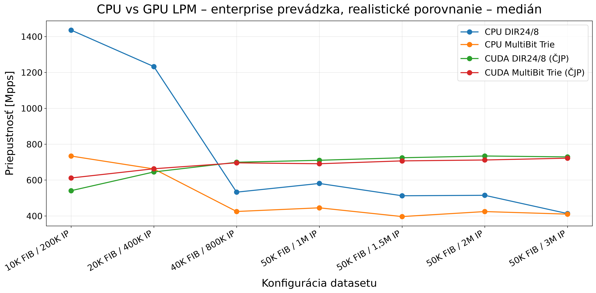
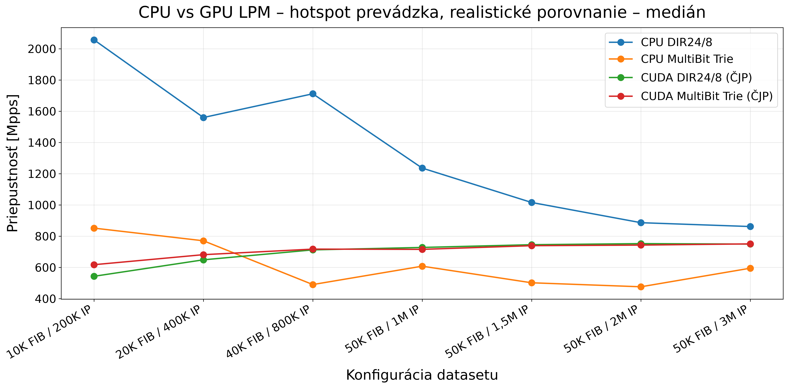
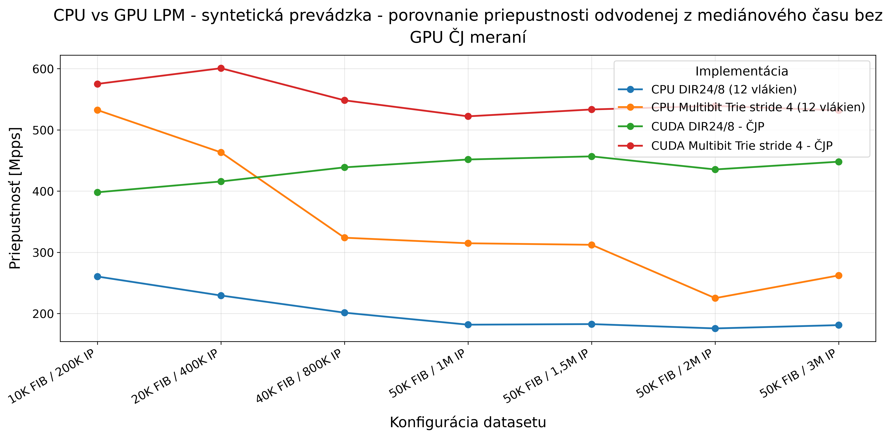
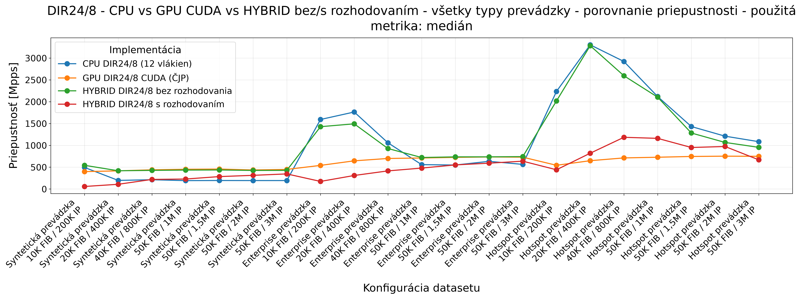
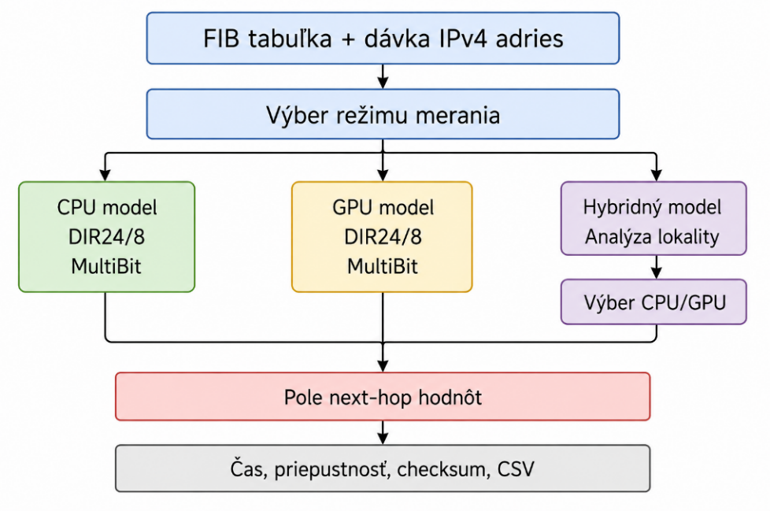

# CUDA IPv4 Longest-Prefix-Match Benchmarks

I built this project as part of my bachelor's thesis on accelerating IPv4 longest-prefix-match (LPM) lookups with CUDA. It brings together my CPU, CUDA and hybrid CPU/GPU implementations of DIR-24-8 and multibit tries, the scripts I used to analyse the measurements, and the benchmark results.

The input datasets can be generated locally, so I have not included the large generated files. The repository does include the measured CSV results and plots; you can review them without rerunning the benchmarks.

## What is in the repository

```text
analysis/plots/       Python scripts for processing CSV results and creating plots
data/                 Generated input data (ignored by Git)
docs/                 Bachelor's thesis and supporting documentation
docs/figures/         Explanatory diagrams
results/benchmarks/   Measured CSV results, grouped by implementation
results/figures/      Plots and derived tables
results/nsight-compute/ Nsight Compute exports
src/common/           Shared path helpers
src/cpu/              CPU implementations
src/cuda/             CUDA implementations
src/hybrid/           Hybrid CPU/GPU implementation
src/data-generation/  Input dataset generators
build/                Local compiler output; ignored by Git
```

## Results

I generated these plots from the included CSV files using the scripts in `analysis/plots/`.









The complete set of plots is in `results/figures/`. The diagram below shows the system and workflow used in the project. Results depend on the hardware and software environment used for each measurement; the thesis and CSV metadata provide context for interpreting them.



## Recreate the plots

Install Python 3 and the libraries listed in `requirements.txt`:

```powershell
python -m pip install -r requirements.txt
```

From the repository root, set the project root and run an analysis script. For example:

```powershell
$env:LPM_PROJECT_ROOT = (Get-Location).Path
python analysis/plots/process_cpu_gpu_all_lpm_enterprise.py
```

The scripts read the relevant CSV files from `results/benchmarks/` and save plots and derived tables to `results/figures/`.

## Generate the input data

The generated datasets are not tracked because they can be large. I have included the generators:

- `generate_synthetic_FIB.cpp` writes FIB CSV files to `data/fib/` and synthetic IP CSV files to `data/traffic/synthetic/` by default.
- `dataset_generator_enterprise_hotspot.py` reads synthetic IP CSV files from `data/traffic/synthetic/` and writes enterprise and hotspot query BIN files to `data/traffic/enterprise/` and `data/traffic/hotspot/`.

These paths are resolved relative to `LPM_PROJECT_ROOT`. The C++ generator requires a C++ compiler. The benchmark implementations require a suitable C++ or CUDA toolchain, and CUDA execution requires a compatible GPU. The current generators do not use `data/samples/`.

`build/` is for local compiled programs and temporary build files; it is not needed to browse the source or recreate the plots. I use `docs/figures/` for explanatory diagrams and `results/figures/` for benchmark plots.

## Bachelor's thesis

I wrote the thesis *Urýchlenie smerovania s použitím CUDA* at the Slovak University of Technology in Bratislava, Faculty of Electrical Engineering and Information Technology (2026). The PDF is available at [docs/thesis.pdf](docs/thesis.pdf).

Suggested citation: Dzivjak, Tomáš. *Urýchlenie smerovania s použitím CUDA*. Bachelor's thesis, Slovak University of Technology in Bratislava, Faculty of Electrical Engineering and Information Technology, 2026.

The thesis PDF is included for reading and citation. Its copyright and any third-party material in it remain subject to the applicable rights and publication agreement. The source code has no reuse license at this time.

## License

I have not added a license for the source code. All rights are reserved unless I add a license later. The thesis PDF and third-party material may have separate rights.
